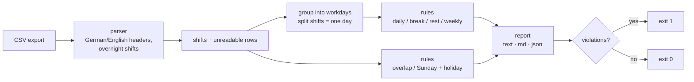

# shift-plan-compliance-checker

[](https://github.com/nikita-automation/shift-plan-compliance-checker/actions/workflows/ci.yml)

Plausibility checks for shift plans, modelled on the German working-time law (*Arbeitszeitgesetz*, ArbZG).
Feed it a CSV export of a shift plan; it flags days over 10 hours, missing breaks, too little rest between
shifts, unapproved Sunday and public-holiday work, double bookings and more — **before** the plan goes out.

Pure Python standard library, no dependencies, no network. Runs as a CLI, as a CI gate (exit code), or as a
step inside an automation workflow (JSON output).

> **Independent demo.** All names and data in this repository are fictional. The code was written from scratch
> as a reference implementation of a generic problem and is not derived from any company's system or data.
> The rules are a starting point for *plausibility checks*, **not legal advice** — see [docs/RULES.md](docs/RULES.md).

## Quick start

```bash
git clone https://github.com/nikita-automation/shift-plan-compliance-checker
cd shift-plan-compliance-checker
PYTHONPATH=src python3 -m shiftcheck check data/sample/shift_plan.csv
```

Python 3.9+ is enough. Output on the bundled sample plan (36 shifts, 6 fictional employees, problems planted on purpose):

```
36 shifts, 6 employees: 7 violation(s), 8 warning(s), 3 note(s), 1 unreadable row(s)

  INPUT      row 38   time out of range: '25:00'
  VIOLATION  Anna Beispiel  2026-10-06   BREAK              10 h 30 min worked needs a break of at least 45 min, plan has 30 min
             -> ArbZG § 4
  VIOLATION  Anna Beispiel  2026-10-06   DAILY_MAX          10 h 30 min worked - above the absolute limit of 10 h per day
             -> ArbZG § 3
  VIOLATION  Ben Muster     2026-10-08   REST               only 8 h of rest between shift end (07.10. 22:00) and next shift start (08.10. 06:00) - 11 h uninterrupted rest required
             -> ArbZG § 5
  ...
```

## What it checks

| Rule | Severity | What it flags | Basis |
|---|---|---|---|
| `DAILY_MAX` | violation | more than 10 h of work in a day | ArbZG § 3 |
| `DAILY_OVER_8` | warning | more than 8 h — only allowed if the average stays at 8 h (6 months / 24 weeks) | ArbZG § 3 |
| `BREAK` | violation | < 30 min break above 6 h, < 45 min above 9 h (gaps ≥ 15 min between split shifts count) | ArbZG § 4 |
| `REST` | violation | less than 11 h between the end of one working day and the start of the next | ArbZG § 5 |
| `SUNDAY_HOLIDAY` | violation | Sunday / public-holiday work without a documented approval | ArbZG § 9, § 10 |
| `SUNDAY_HOLIDAY_OK` | note | approved work on Sunday / holiday — reminds you of the compensatory day off | ArbZG § 11 |
| `FREE_SUNDAYS` | warning | plan is on pace to leave fewer than 15 free Sundays per year | ArbZG § 11 |
| `WEEKLY_OVER` | warning | more than 48 h in a calendar week | ArbZG § 3 |
| `OVERLAP` | violation | the same person booked twice at the same time (data quality) | — |

Details, what is modelled and what deliberately is not: [docs/RULES.md](docs/RULES.md).

## Input

A CSV (comma **or** semicolon separated, UTF-8, German or English headers):

```csv
employee,date,start,end,break_minutes,approved
Anna Beispiel,2026-10-06,08:00,19:00,30,
Clara Probe,2026-10-24,22:00,06:00,30,yes
```

- `end` earlier than `start` means the shift runs past midnight and is attributed to the day it starts.
- `approved` marks Sunday / holiday work that has a documented exception (`yes`/`ja`/`1`/`true`).
- German headers work too: `Mitarbeiter;Datum;Beginn;Ende;Pause;Genehmigt`, dates as `05.10.2026`.
- Unreadable rows never abort the run — they are listed with their spreadsheet row number so one typo does
  not hide the other 200 rows.

## Use it

```bash
# human-readable report, exit code 1 if there are violations (or unreadable rows)
PYTHONPATH=src python3 -m shiftcheck check plan.csv

# machine-readable, for automation workflows
PYTHONPATH=src python3 -m shiftcheck check plan.csv --format json --fail-on never

# Markdown report (paste into a ticket or e-mail)
PYTHONPATH=src python3 -m shiftcheck check plan.csv --format md

# different limits (e.g. a sector rule with 10 h rest), different holiday calendar
PYTHONPATH=src python3 -m shiftcheck check plan.csv --rules my_rules.json --region DE

# holidays of a year, computed from the Easter date
PYTHONPATH=src python3 -m shiftcheck holidays 2027
```

All limits live in [rules.default.json](rules.default.json); a custom file only needs the keys you change.
Unknown keys are rejected so a typo cannot silently disable a rule.

### In an automation workflow

The JSON report has a stable shape (`summary`, `unreadable_rows`, `findings[]`), so it drops into any workflow
tool: run the checker in an *Execute Command* / script step, branch on `summary.violations`, and send the
`findings` to whoever plans the shifts. The exit code does the same job in a CI pipeline or cron job.

## How it works



Design decisions worth knowing:

- **Working day, not calendar row.** Shifts that start on the same day form one working day. Hours are
  summed, and a gap of at least 15 minutes between split shifts counts as break. No rest period is demanded
  *inside* a working day.
- **Overnight shifts are measured by their real end.** Rest is computed from the real end time, and a
  Saturday-night shift is flagged on the Sunday it touches.
- **Severity is honest.** Things the law allows with averaging (more than 8 h a day, more than 48 h a week)
  are warnings, not violations — the tool cannot see the time account.
- **Boundaries are tested.** Exactly 10 h is fine, 10 h 1 min is not; a 15-minute gap counts, a 14-minute one
  does not. The test suite was checked with mutation testing: flipping each comparison (`>` ↔ `>=`) makes at
  least one test fail.
- **Holidays without a data file.** Moveable holidays derive from the Easter date; regions `NW` (North
  Rhine-Westphalia) and `DE` (nationwide holidays only) are included.

## Tests

```bash
PYTHONPATH=src python3 -m unittest discover -s tests
```

50 tests: rule boundaries, parser edge cases, holidays, CLI, and a golden test that the bundled sample plan
produces exactly the planted findings. CI runs them on Python 3.9 and 3.12 and also runs the CLI end to end.

## Limitations

- Not legal advice. Collective agreements, sector exceptions (ArbZG § 10) and the 6-month averaging are out of
  scope — configure the limits or treat warnings as prompts to look at the time account.
- One `break_minutes` value per shift: the tool cannot check *when* the break is taken (e.g. "no more than 6 h
  without a break").
- Night-work rules, young-worker and maternity-protection rules are not modelled.
- Holiday calendars: `NW` and `DE` only.

## License

MIT — see [LICENSE](LICENSE).
